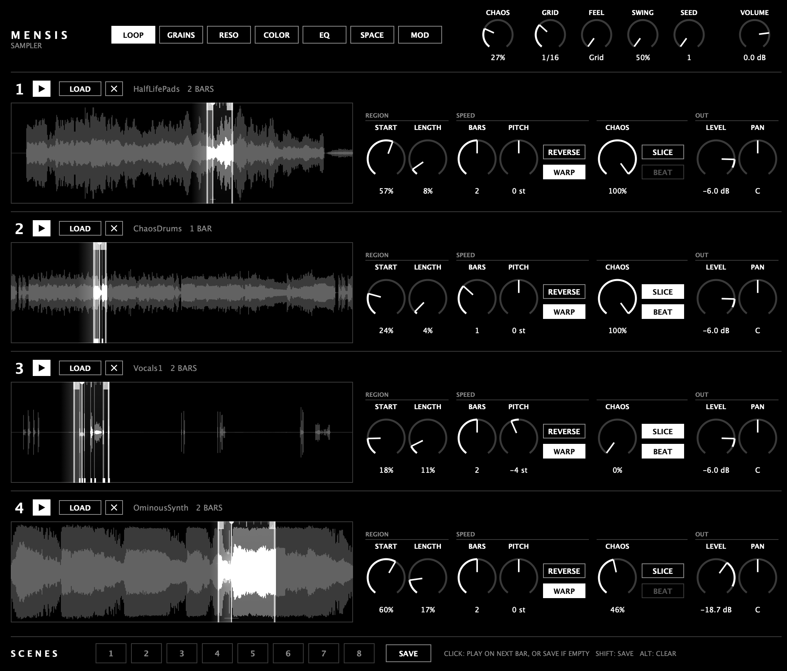

# Mensis Sampler

A sampler plugin (VST3 + AU) for Ableton Live 12 on macOS that plays itself, inspired by the Torso S-4.

You don't play it like a piano. Load up to 4 samples and each one loops in sync with Live. Then use
the knobs and the **Chaos** knob to shape them: jumps, stutters, reverse, grain clouds, resonance,
dirt and space.



## What it does

- **4 tracks in one instance.** Each track loops a region of a sample over 1, 2, 4… bars, locked to
  Live's tempo. Warp keeps the pitch when the tempo changes; tape mode lets speed and pitch move together.
- **Chaos.** One knob adds glitches on a rhythmic grid (jump, reverse, stutter, dropout). The same
  **Seed** at the same song position always gives the same result, so a take you like can be repeated.
- **Slice + Beat.** Drum loops are cut at their hits automatically. Chaos jumps then land on hits, and
  BEAT mode remixes the loop like a drummer, always on the grid. Swing is global.
- **Per track sound chain:** Loop → Grains → Resonator → Filter → Color → EQ.
  - **Grains:** a cloud of short grains around the playhead (size, density, spray, detune, freeze).
  - **Reso:** tuned resonators (root + chord, string to bell). Play MIDI notes into Mensis to change them.
  - **Color:** drive, bit crush, sample-rate crush, one-knob compressor, tilt EQ.
  - **EQ:** morphing filter (low/band/high-pass) + 3-band EQ.
- **Space:** one shared delay + reverb with a send per track, and Freeze.
- **Mod:** 4 modulators (LFO, Random, Envelope follower with sidechain) that you map by touching any
  knob, plus 4 macros: Destroy, Drift, Ring, Space.
- **Play, Mute, Solo** per track. Play starts and stops a track on the next bar.
- **Scenes:** 8 snapshots of all knobs. Click one and it takes over at the next bar.
- **Saved with the Live set**, including the samples themselves (up to 20 MB each), so sets still
  open on another machine.

## Install (build from source, macOS)

```bash
brew install cmake ninja
cmake -B build -G Ninja -DCMAKE_BUILD_TYPE=RelWithDebInfo
cmake --build build
```

The build copies `Mensis Sampler.vst3` and `Mensis Sampler.component` into `~/Library/Audio/Plug-Ins/`.
In Live, rescan plugins and drop **Mensis Sampler** on a MIDI track.

## Test

```bash
ctest --test-dir build --output-on-failure
```

Plugin validation uses [pluginval](https://github.com/Tracktion/pluginval/releases) (unzip into `tools/bin/`):

```bash
tools/bin/pluginval.app/Contents/MacOS/pluginval --strictness-level 5 --validate-in-process \
  --skip-gui-tests --validate "build/plugin/MensisSampler_artefacts/RelWithDebInfo/VST3/Mensis Sampler.vst3"
```

## Offline render (no DAW)

`mensis-cli` renders one track to a WAV file. Run it with no arguments to see every option.

```bash
./build/cli/mensis-cli_artefacts/RelWithDebInfo/mensis-cli loop drums.wav --bpm 120 --bars 2 \
  --chaos 0.5 --seed 7 --out out/loop.wav
./build/cli/mensis-cli_artefacts/RelWithDebInfo/mensis-cli slices drums.wav   # where the hits are
```

## Code layout

```
core/     all DSP and logic (no plugin or GUI code)
plugin/   JUCE wrapper: Live <-> core, and the UI
cli/      mensis-cli, offline render
tests/    Catch2 tests
tools/    Python check/plot scripts
docs/     roadmap (PLAN.md), research, design notes
```

Built with C++20, JUCE, CMake and Catch2. Roadmap and design notes: [`docs/PLAN.md`](docs/PLAN.md).
